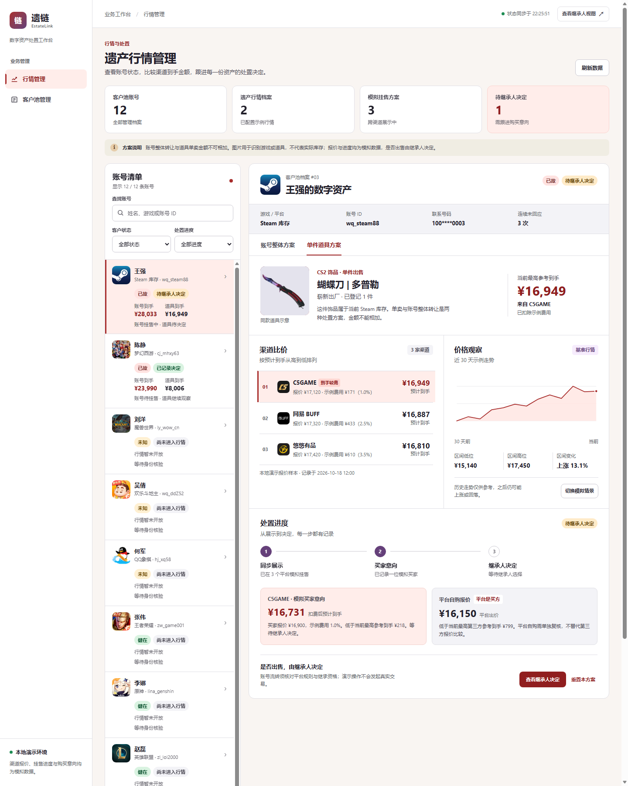

# 遗链 EstateLink · 行情与处置演示

这是接入客户池示例代码的行情模块，包含运营后台和继承人手机端。账号整体转让与道具单卖分别展示多平台示例报价、预计到手、价格走势、模拟挂售、买家意向和处置决定。

## 启动

只需 Python 3，不依赖第三方包：

~~~powershell
python demo/server.py
~~~

服务默认仅监听本机 `127.0.0.1:3000`。客户姓名、账号、身份证号、手机号和密码均为虚构演示数据；身份证地区码 `000000`、手机号段 `100` 和 `DEMO_ONLY` 密码均是无效占位值。请勿录入真实个人信息。

- **行情管理后台**：<http://localhost:3000/market-admin>
- 客户池管理页：<http://localhost:3000/>
- 继承人手机端：<http://localhost:3000/mobile?userId=3&tab=sell>

录屏时可把自动核验间隔调长，避免客户池的其他演示事件打断行情流程：

~~~powershell
$env:AUTO_INTERVAL='999999'
python demo/server.py
~~~

## 建议演示顺序

1. 打开行情管理后台，查看全部客户池账号。用姓名、游戏或账号 ID 搜索，也可按客户池状态和处置进度筛选。初始示例有 12 条账号，其中 2 条已故档案配置了行情。
2. 选择王强，切换“账号整体”和“单件道具”，对比平台报价、费用、预计到手、价格波动及各自的挂售状态。两种方案的金额不可相加。
3. 选择陈静的账号整体方案，点击“模拟同步挂售”“模拟买家意向”。后台会显示“待继承人决定”。
4. 点击“查看继承人决定”，在手机端选择“继续观察”“同意按此意向出售”，或查看明确披露买方身份的“平台自购方案”。返回后台可看到同步后的决定。
5. 点击“重置本方案”可重新演示这一方案；其他账号和道具方案的进度不受影响。

## 演示数据与接口

客户池由原有 Python 标准库服务提供。行情后台通过 `GET /api/market/overview` 获取全部账号的**行情相关字段**、示例报价和处置进度，不返回密码或身份证号。`POST /api/market/flow` 校验身份状态及流程顺序，供后台和手机端共同更新模拟进度。两端每 5 秒同步一次状态，也可在后台手动刷新。

报价、手续费、买家意向和平台自购报价均为**模拟数据**，集中放在 `demo/market_catalog.json`，未连接真实交易平台。演示进度自动保存到 `demo/market_state.json`，便于服务重启后继续展示；该文件已加入 `.gitignore`。

后台账号清单、资产详情和两端的渠道报价使用本地 WebP 图片，现场演示无需加载外部图片。图片仅用于辨认游戏、道具类型与渠道，不代表真实客户库存；来源见 [`demo/assets/SOURCES.md`](demo/assets/SOURCES.md)。相关商标和图片权利归原权利方所有，正式使用前需核对授权。

本演示不发起真实挂单、收购或支付。真实产品仍需继承资格核验、平台转让规则核对、行情接口、授权与后台访问控制。
